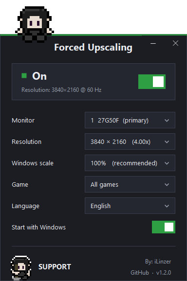
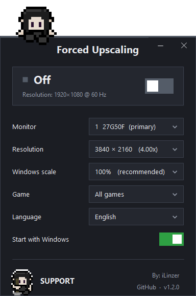

<p align="center">
  
</p>

<h1 align="center">Forced Upscaling</h1>

<p align="center">
  Make games render above your monitor's resolution with NVIDIA DSR, then let the GPU scale the picture back down.<br>
  A sharper image and a lot less aliasing, from a tray icon, in any game.
</p>

<p align="center">
  <a href="https://github.com/Linzer-Cyberheart/ForcedUpscaling/releases/latest"></a>
  <a href="LICENSE"></a>
  
  
</p>

<p align="center">
  English | <a href="README.pt-BR.md">Português (Brasil)</a>
</p>

<p align="center">
  
  &nbsp;&nbsp;
  
</p>

## What it does

A lot of PC games, mostly older ones and console ports, run in borderless windowed mode and simply use the size of your desktop. Picking 4K in the game's menu changes nothing, because the game follows whatever Windows is showing.

NVIDIA's DSR (Dynamic Super Resolution) lets Windows offer resolutions higher than your monitor can display, for example 3840 x 2160 on a 1080p screen. The GPU renders at that size and scales the result down to fit. That is supersampling: edges get smoother and fine detail gets cleaner, without touching the game's own settings.

Forced Upscaling puts that behind a tray icon. Turn it on, start any game, turn it off when you're done.

I made it for OneeChanbara Origin. Its config file has a 3840 x 2160 option, but in borderless mode the game ignores it and draws at your desktop size. With the desktop in 4K, the game finally renders in 4K.

## Features

- One click from the tray icon or the window, no install, a single `.exe`
- Works with any game that renders at the desktop size (borderless and windowed modes)
- Multiple monitors: you choose which one to use, the others keep their resolution
- Pick the resolution you want (1.50x, 2.00x, 4.00x, whatever your driver offers)
- Controls the Windows scale while it's on, so old games that don't understand DPI settings still get the real resolution
- Everything is temporary. Nothing is written to the registry, and a reboot always brings your monitor back
- No admin rights, no services, nothing running except the tray icon
- English, Portuguese, Chinese and Spanish, picked from your Windows language the first time
- Optional start with Windows

## Download

1. Get `ForcedUpscaling.exe` from the [latest release](https://github.com/Linzer-Cyberheart/ForcedUpscaling/releases/latest).
2. Put it in a folder you won't delete. If you turn on "Start with Windows" it launches from there.
3. Run it. The window opens and an icon shows up in the tray.

Windows SmartScreen may complain the first time, because the file isn't code signed. If you'd rather not trust a random exe, the source is short and `build.bat` builds it in a few seconds (see below).

## Set up DSR first

DSR has to be switched on in the NVIDIA Control Panel:

1. Open the NVIDIA Control Panel
2. Manage 3D settings, Global settings
3. Find **DSR - Factors** and tick the ones you want (1.50x, 2.00x, 4.00x...)
4. Apply

If the app says "No DSR resolutions available", this is the step you're missing.

## Using it

- Double-click the tray icon to open the window, or right-click it for the menu (turn it on or off there or in the window)
- Once you turn it on, it stays on: if a game exits or is minimized and Windows drops the resolution, the app puts it back, except while a full screen game is in front
- The window has the same controls plus the monitor, the resolution, the Windows scale and the language
- Turn it on **before** you start the game. Games that take the desktop size read it when they open
- Turn it off when you're done. Closing the app also turns it off

## Fixes for specific games

Some games need more than a bigger desktop. Pick the game under "Game" in the window. The app then fixes it in memory when the game starts, and nothing on disk changes, so Steam's file check stays happy. The mode has to be on before the game opens.

- **Dynasty Warriors 8 Empires** and **Xtreme Legends**: they only list resolutions up to 1920 x 1200, so the app adds the screen size to the list and to the places in the code that build the screen. Empires also gets a depth of field setting (Normal, Weak, Off).
- **Onechanbara Z2: Chaos**: the window already follows the desktop, but the game builds the scene at 1920 x 1080 and stretches it. The "Internal resolution" setting, on by default, makes it build the scene at the screen size.

About the Windows scale: at 3840 x 2160 Windows usually picks 150%. Games that don't handle DPI get drawn at 1440p and stretched, which defeats the point. So the app switches the scale to 100% while it's on and puts it back afterwards. You can change that in the window.

## Troubleshooting

**"The driver refused the resolution"**
On my machine (Windows 11, GTX 1660) the 4K DSR mode showed up everywhere but Windows refused to apply any of them, the screen would blink and go back. Unticking every DSR factor in the NVIDIA Control Panel, applying, and ticking them again fixed it immediately. I've seen similar reports after big Windows updates, so it's worth a try.

**The screen is stuck at the high resolution**
Turn it off from the tray, or run `scripts/reset-display.bat`. A reboot also fixes it. If you're not sure which monitor is affected, check the Monitor row in the window.

**I can't see the tray icon**
Windows 11 hides new tray icons behind the little arrow. Drag it out, or go to Settings, Personalization, Taskbar, Other system tray icons.

**The game still looks soft**
Some games have their own internal render scale or lock their resolution. The app can only change what the desktop offers to them.

## FAQ

**Does it work with exclusive fullscreen?**
Most exclusive fullscreen games list the DSR resolutions in their own menu, so you don't need this for them. It does no harm if you do use it.

**Will it cost me performance?**
Yes. 3840 x 2160 is four times the pixels of 1920 x 1080, so the GPU has a lot more work. Try 1.50x or 2.00x if 4K is too heavy.

**What happens to my other monitors?**
Only the monitor you pick in the window (or the tray menu) changes. The others keep their resolution. While one monitor is in the bigger mode, Windows may place its neighbors a bit differently, and they go back when you turn the mode off.

**AMD or Intel?**
The app asks Windows for any resolution larger than your current one with the same aspect ratio, so anything your driver lists will show up, AMD's VSR included. I've only tested it on NVIDIA, so I can't promise anything.

**Does it work on Windows 10?**
It should. I've only tested it on Windows 11.

**Is anything saved on my PC?**
A small settings file in `%APPDATA%\ForcedUpscaling` and, if you enable it, a Run entry in your user registry for the autostart. That's all.

## Build from source

You only need Windows. The C# compiler that ships with .NET Framework 4 is enough, no Visual Studio or SDK.

```
build.bat
```

The result is `bin\ForcedUpscaling.exe`, with the icons and animations built into it.

## How it works

Switching uses `ChangeDisplaySettingsEx` without the update-registry flag, so the change is temporary by design. The Windows scale is read and set through the DisplayConfig "device info" requests that the Settings app uses. They're not documented, so they could change in a future Windows version. If they ever stop working the rest of the app keeps going and you just lose the scale control.

## Credits

Made by [iLinzer](https://www.youtube.com/@iLinzer?sub_confirmation=1). The mascot and the icons are my own artwork.

If the app helped you, you can support the project on [GitHub Sponsors](https://github.com/sponsors/Linzer-Cyberheart), from anywhere in the world. A star on the repository helps too.

## License

The code is under the [MIT license](LICENSE). The artwork in `assets/` is not, see [assets/LICENSE.txt](assets/LICENSE.txt).
