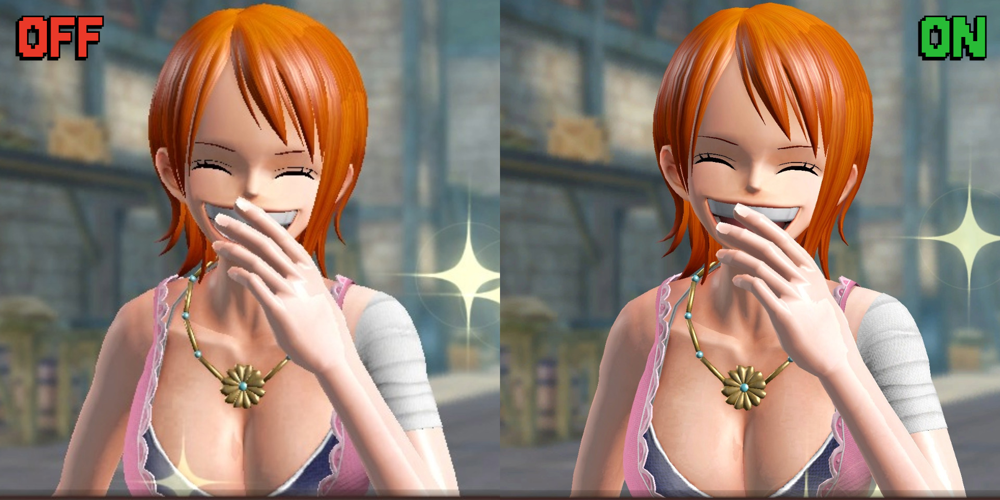
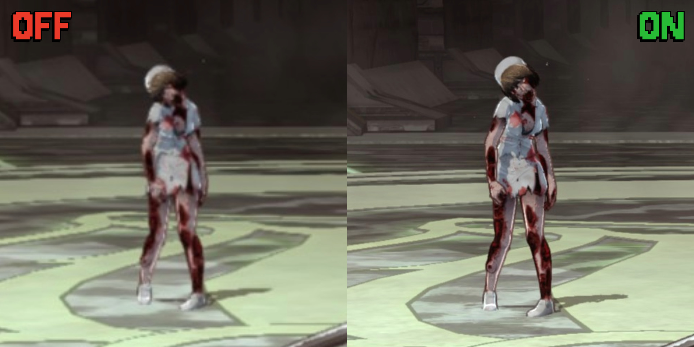
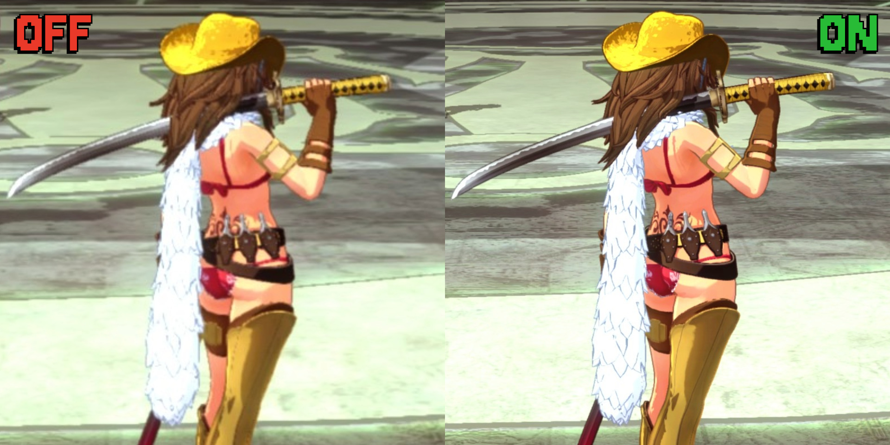
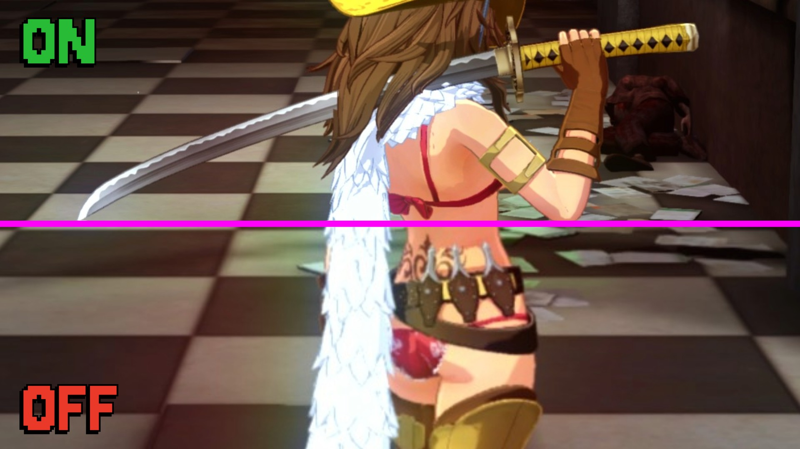
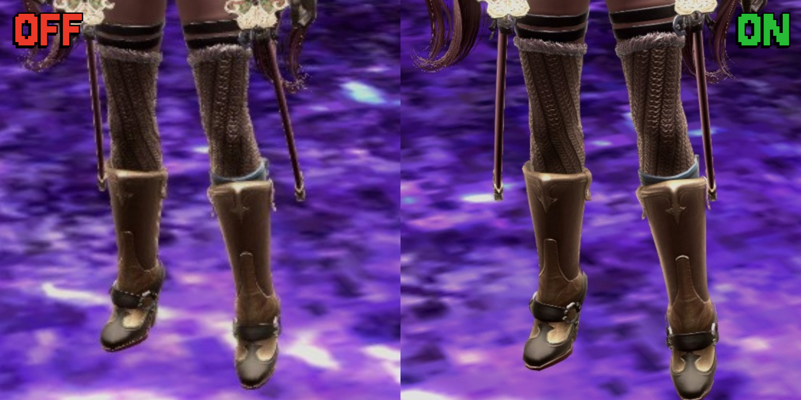
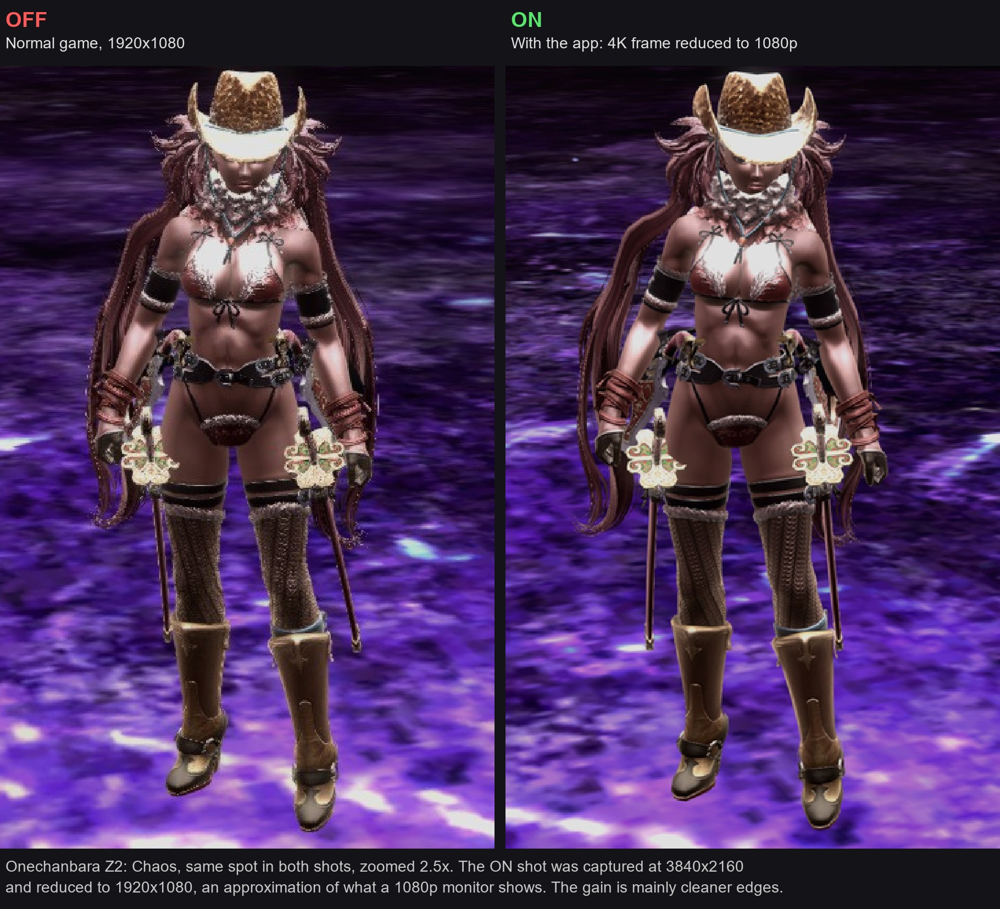
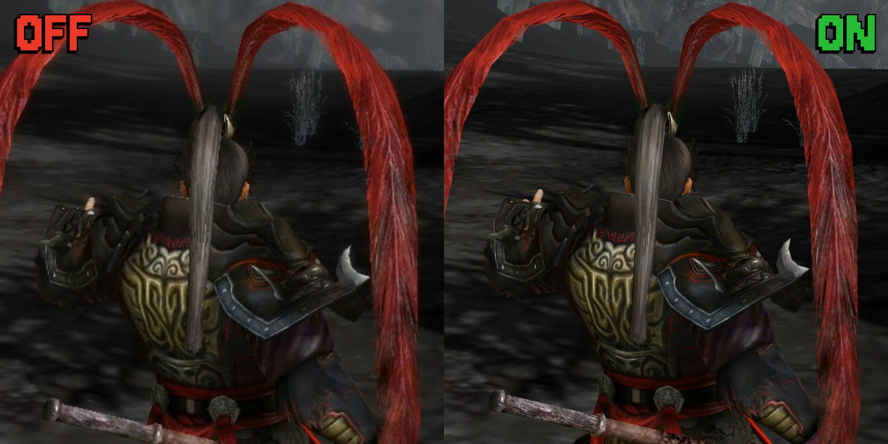

<p align="center">
  
</p>

<h1 align="center">Forced Supersampling</h1>

<p align="center">
  Faça os jogos renderizarem acima da resolução do seu monitor com o DSR da NVIDIA e deixe a placa de vídeo reduzir a imagem depois.<br>
  Imagem mais nítida e bem menos serrilhado, por um ícone na bandeja, em qualquer jogo.
</p>

<p align="center">
  <a href="https://github.com/Linzer-Cyberheart/ForcedSupersampling/releases/latest"></a>
  <br>
  <sub>Clique no botão e, na página que abrir, clique em <b>ForcedSupersampling.exe</b> na parte "Assets". Não tem instalador: é só executar o arquivo.</sub>
</p>

<p align="center">
  <a href="https://github.com/Linzer-Cyberheart/ForcedSupersampling/releases/latest"></a>
  <a href="LICENSE"></a>
  
  
</p>

<p align="center">
  <a href="README.md">English</a> | Português (Brasil)
</p>

<p align="center">
  
  <br>
  <sub>One Piece: Pirate Warriors 3. Desligado à esquerda, ligado à direita. Só o programa ligado, nada específico do jogo.</sub>
</p>

<p align="center">
  
  &nbsp;&nbsp;
  
</p>

## O que ele faz

Muitos jogos de PC, principalmente os mais antigos e as conversões de console, rodam em janela sem borda e usam só o tamanho da sua área de trabalho. Escolher 4K no menu do jogo não muda nada, porque ele segue o que o Windows está mostrando.

O DSR (Dynamic Super Resolution) da NVIDIA faz o Windows oferecer resoluções maiores do que o monitor consegue exibir, por exemplo 3840 x 2160 em uma tela 1080p. A placa renderiza nesse tamanho e reduz o resultado para caber. Isso é supersampling: as bordas ficam mais suaves e os detalhes mais limpos, sem mexer nas configurações do jogo.

O Forced Supersampling coloca isso atrás de um ícone na bandeja. Ligue, abra qualquer jogo, desligue quando terminar.

Fiz para o OneeChanbara Origin. O arquivo de configuração dele tem a opção 3840 x 2160, mas em modo sem borda o jogo ignora e desenha no tamanho da área de trabalho. Com a área de trabalho em 4K, o jogo finalmente renderiza em 4K.

## Mais antes e depois

Desligado à esquerda, ligado à direita, no mesmo ponto do jogo.

<p align="center">
  
  <br>
  <sub>OneeChanbara Origin. Só o programa ligado.</sub>
</p>

<p align="center">
  
  <br>
  <sub>OneeChanbara Origin. Só o programa ligado.</sub>
</p>

<p align="center">
  
  <br>
  <sub>OneeChanbara Origin, outra cena. Esta está dividida ao contrário: ligado em cima, desligado embaixo.</sub>
</p>

<p align="center">
  
  <br>
  <sub>Onechanbara Z2: Chaos, com o ajuste "Resolução interna". Um recorte ampliado das botas.</sub>
</p>

<p align="center">
  
  <br>
  <sub>Onechanbara Z2: Chaos, a personagem inteira no mesmo ponto, ampliada 2,5x. Ligado é o quadro em 4K reduzido para 1080p, uma aproximação do que um monitor 1080p mostra.</sub>
</p>

<p align="center">
  
  <br>
  <sub>Dynasty Warriors 8 Empires, com a correção do jogo.</sub>
</p>

## Recursos

- Um clique pela bandeja ou pela janela, sem instalação, um único `.exe`
- Funciona com qualquer jogo que renderize no tamanho da área de trabalho (modo sem borda e em janela)
- Funciona com mais de um monitor: você escolhe qual usar, os outros mantêm a resolução. No meu PC o Windows não deixava trocar a resolução com dois monitores conectados, e o app resolve isso
- Escolha a resolução (1.50x, 2.00x, 4.00x, o que o seu driver oferecer)
- Controla a escala do Windows enquanto está ligado, assim jogos antigos que não entendem DPI recebem a resolução real
- Tudo é temporário. Nada é gravado no registro e reiniciar sempre devolve o monitor ao normal
- Sem administrador, sem serviços, nada rodando além do ícone da bandeja
- Inglês, português, chinês e espanhol, escolhido pelo idioma do Windows na primeira vez
- Iniciar com o Windows é opcional

## Download

1. Baixe o `ForcedSupersampling.exe` na [última versão](https://github.com/Linzer-Cyberheart/ForcedSupersampling/releases/latest).
2. Coloque em uma pasta que você não vai apagar. Se ativar "Iniciar com o Windows", ele abre a partir dela.
3. Execute. A janela abre e um ícone aparece na bandeja.

O Forced Supersampling se chamava Forced Upscaling até a versão 1.2.0. É o mesmo app e suas configurações continuam. Se você usa "Iniciar com o Windows", a entrada se corrige sozinha na primeira vez que abrir o novo exe, e dá para apagar o antigo.

O Windows SmartScreen pode reclamar na primeira vez, porque o arquivo não é assinado. Se preferir não confiar em um exe qualquer, o código-fonte é curto e o `build.bat` compila em alguns segundos (veja abaixo).

### Situação nos antivírus (versão 1.2.2)

O exe é novo e não é assinado, então antivírus que julgam arquivos desconhecidos pela reputação podem marcá-lo. Situação em 15 de novembro de 2026:

- **VirusTotal:** [0 de 71 antivírus o marcam](https://www.virustotal.com/gui/file/b98da0600372f8f9657e024fd38de84366aafc0119bfb1a5ee644c1063e5fd2c).
- **Microsoft Defender:** em um PC ele marcou esta versão como `Trojan:Script/Conteban.A!ml`, uma detecção por aprendizado de máquina, quando o arquivo foi baixado e executado. Acredito que seja falso positivo e enviei o arquivo para a Microsoft analisar em 15 de novembro de 2026. Vou atualizar esta seção com a resposta.
- **SHA-256 do `ForcedSupersampling.exe` 1.2.2:** `b98da0600372f8f9657e024fd38de84366aafc0119bfb1a5ee644c1063e5fd2c`. Confira o do seu arquivo.

O código-fonte é público e cada versão é compilada a partir dele pelo GitHub Actions, então dá também para compilar você mesmo.

## Ative o DSR antes

O DSR precisa estar ligado no Painel de Controle da NVIDIA:

1. Abra o Painel de Controle da NVIDIA
2. Gerenciar configurações em 3D, Configurações globais
3. Procure **DSR - Fatores** e marque os que quiser (1.50x, 2.00x, 4.00x...)
4. Aplique

Se o app mostrar "Nenhuma resolução DSR disponível", falta esse passo.

## Como usar

- Dê dois cliques no ícone da bandeja para abrir a janela, ou clique com o botão direito para ver o menu (liga e desliga ali ou na janela)
- Depois de ligar, ele fica ligado: se um jogo sair ou for minimizado e o Windows derrubar a resolução, o app a coloca de volta, exceto enquanto um jogo em tela cheia estiver na frente
- A janela tem os mesmos controles, mais o monitor, a resolução, a escala do Windows e o idioma
- Ligue **antes** de abrir o jogo. Jogos que usam o tamanho da área de trabalho leem esse valor quando abrem
- Desligue quando terminar. Fechar o app também desliga

## Correções para jogos específicos

Alguns jogos precisam de mais que uma área de trabalho maior. Escolha o jogo em "Jogo" na janela. O app então corrige o jogo na memória quando ele abre, sem mudar nada no disco, então a conferência de arquivos do Steam continua feliz. O modo precisa estar ligado antes de abrir o jogo.

- **Dynasty Warriors 8 Empires** e **Xtreme Legends**: só listam resoluções até 1920 x 1200, então o app coloca o tamanho da tela na lista e nos pontos do código que montam a tela. O Empires ainda ganha um ajuste de profundidade de campo (Normal, Fraco, Desligado).
- **Onechanbara Z2: Chaos**: a janela já acompanha a área de trabalho, mas o jogo monta a cena em 1920 x 1080 e estica. O ajuste "Resolução interna", ligado por padrão, faz o jogo montar a cena no tamanho da tela.

Sobre a escala do Windows: em 3840 x 2160 o Windows costuma escolher 150%. Jogos que não tratam DPI são desenhados em 1440p e esticados, o que anula o objetivo. Por isso o app coloca a escala em 100% enquanto está ligado e devolve depois. Dá para mudar isso na janela.

## Problemas comuns

**"O driver recusou a resolução"**
No meu PC (Windows 11, GTX 1660) o modo 4K do DSR aparecia em todo lugar, mas o Windows recusava aplicar qualquer um: a tela piscava e voltava. Desmarcar todos os fatores DSR no Painel da NVIDIA, aplicar e marcar de novo resolveu na hora. Vi relatos parecidos depois de atualizações grandes do Windows, então vale tentar.

**A tela ficou presa na resolução alta**
Desligue pela bandeja ou execute `scripts/reset-display.bat`. Reiniciar o PC também resolve. Se não tiver certeza de qual monitor foi afetado, veja a linha Monitor na janela.

**Não vejo o ícone na bandeja**
O Windows 11 esconde ícones novos atrás da setinha. Arraste para fora, ou vá em Configurações, Personalização, Barra de tarefas, Outros ícones da bandeja.

**O jogo continua borrado**
Alguns jogos têm escala interna de renderização própria ou travam a resolução. O app só muda o que a área de trabalho oferece a eles.

## Perguntas frequentes

**Funciona em tela cheia exclusiva?**
A maioria dos jogos em tela cheia exclusiva lista as resoluções DSR no próprio menu, então você não precisa disso para eles. Não faz mal usar mesmo assim.

**Vai custar desempenho?**
Vai. 3840 x 2160 tem quatro vezes os pixels de 1920 x 1080, então a placa trabalha bem mais. Se o 4K pesar demais, teste 1.50x ou 2.00x.

**E os meus outros monitores?**
Só o monitor que você escolher na janela (ou no menu da bandeja) muda. Os outros mantêm a resolução. Funciona com dois monitores conectados, o que o próprio Windows se recusava a fazer no meu PC. Enquanto um monitor está no modo maior, o Windows pode posicionar os vizinhos de um jeito um pouco diferente, e eles voltam quando você desliga.

**AMD ou Intel?**
O app pede ao Windows qualquer resolução maior que a atual com a mesma proporção, então o que o seu driver listar aparece, inclusive o VSR da AMD. Só testei em NVIDIA, então não prometo nada.

**Funciona no Windows 10?**
Deveria. Só testei no Windows 11.

**Algo fica gravado no meu PC?**
Um pequeno arquivo de configuração em `%APPDATA%\ForcedUpscaling` e, se você ativar, uma entrada Run no registro do seu usuário para iniciar com o Windows. Só isso.

## Compilar o código

Basta o Windows e o [Build Tools for Visual Studio](https://visualstudio.microsoft.com/visual-cpp-build-tools/), que é gratuito (o compilador de C# vem com ele). Sem arquivo de projeto, sem SDK.

```
build.bat
```

O resultado é `bin\ForcedSupersampling.exe`, com os ícones e as animações embutidos. O script acha o compilador sozinho, compila de forma determinística (o mesmo código sempre gera o mesmo exe), assina o assembly com a chave de strong name do repositório e gera x64. É essa combinação que mantém algumas heurísticas de antivírus quietas; sem o Build Tools o script recorre ao compilador antigo que vem com o Windows, que funciona mas é marcado.

## Como funciona

A troca usa `ChangeDisplaySettingsEx` sem a flag de atualizar o registro, então a mudança é temporária por construção. A escala do Windows é lida e definida pelas requisições "device info" do DisplayConfig que o app Configurações usa. Elas não são documentadas e podem mudar em uma versão futura do Windows. Se pararem de funcionar, o resto do app continua e você só perde o controle da escala.

## Créditos

Feito por [iLinzer](https://www.youtube.com/@iLinzer?sub_confirmation=1). O mascote e os ícones são arte minha.

Se o app te ajudou, você pode apoiar o projeto pelo [GitHub Sponsors](https://github.com/sponsors/Linzer-Cyberheart), de qualquer lugar do mundo. Uma estrela no repositório também ajuda.

## Licença

O código está sob a [licença MIT](LICENSE). A arte em `assets/` não, veja [assets/LICENSE.txt](assets/LICENSE.txt).
