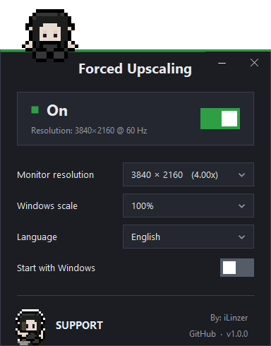
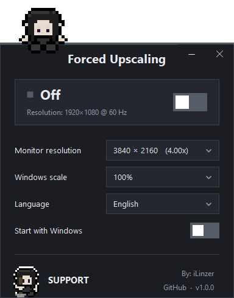

<p align="center">
  
</p>

<h1 align="center">Forced Upscaling</h1>

<p align="center">
  Faça os jogos renderizarem acima da resolução do seu monitor com o DSR da NVIDIA e deixe a placa de vídeo reduzir a imagem depois.<br>
  Imagem mais nítida e bem menos serrilhado, por um ícone na bandeja, em qualquer jogo.
</p>

<p align="center">
  <a href="https://github.com/Linzer-Cyberheart/ForcedUpscaling/releases/latest"></a>
  <a href="LICENSE"></a>
  
  
</p>

<p align="center">
  <a href="README.md">English</a> | Português (Brasil)
</p>

<p align="center">
  
  &nbsp;&nbsp;
  
</p>

## O que ele faz

Muitos jogos de PC, principalmente os mais antigos e as conversões de console, rodam em janela sem borda e usam só o tamanho da sua área de trabalho. Escolher 4K no menu do jogo não muda nada, porque ele segue o que o Windows está mostrando.

O DSR (Dynamic Super Resolution) da NVIDIA faz o Windows oferecer resoluções maiores do que o monitor consegue exibir, por exemplo 3840 x 2160 em uma tela 1080p. A placa renderiza nesse tamanho e reduz o resultado para caber. Isso é supersampling: as bordas ficam mais suaves e os detalhes mais limpos, sem mexer nas configurações do jogo.

O Forced Upscaling coloca isso atrás de um ícone na bandeja. Ligue, abra qualquer jogo, desligue quando terminar.

Fiz para o OneeChanbara Origin. O arquivo de configuração dele tem a opção 3840 x 2160, mas em modo sem borda o jogo ignora e desenha no tamanho da área de trabalho. Com a área de trabalho em 4K, o jogo finalmente renderiza em 4K.

## Recursos

- Um clique pela bandeja ou pela janela, sem instalação, um único `.exe`
- Funciona com qualquer jogo que renderize no tamanho da área de trabalho (modo sem borda e em janela)
- Vários monitores: só o monitor principal muda, os outros mantêm a resolução
- Escolha a resolução (1.50x, 2.00x, 4.00x, o que o seu driver oferecer)
- Controla a escala do Windows enquanto está ligado, assim jogos antigos que não entendem DPI recebem a resolução real
- Tudo é temporário. Nada é gravado no registro e reiniciar sempre devolve o monitor ao normal
- Sem administrador, sem serviços, nada rodando além do ícone da bandeja
- Inglês, português, chinês e espanhol, escolhido pelo idioma do Windows na primeira vez
- Iniciar com o Windows é opcional

## Download

1. Baixe o `ForcedUpscaling.exe` na [última versão](https://github.com/Linzer-Cyberheart/ForcedUpscaling/releases/latest).
2. Coloque em uma pasta que você não vai apagar. Se ativar "Iniciar com o Windows", ele abre a partir dela.
3. Execute. A janela abre e um ícone aparece na bandeja.

O Windows SmartScreen pode reclamar na primeira vez, porque o arquivo não é assinado. Se preferir não confiar em um exe qualquer, o código-fonte é curto e o `build.bat` compila em alguns segundos (veja abaixo).

## Ative o DSR antes

O DSR precisa estar ligado no Painel de Controle da NVIDIA:

1. Abra o Painel de Controle da NVIDIA
2. Gerenciar configurações em 3D, Configurações globais
3. Procure **DSR - Fatores** e marque os que quiser (1.50x, 2.00x, 4.00x...)
4. Aplique

Se o app mostrar "Nenhuma resolução DSR disponível", falta esse passo.

## Como usar

- Dê dois cliques no ícone da bandeja para ligar ou desligar, ou clique com o botão direito para ver o menu
- A janela tem os mesmos controles, mais a resolução, a escala do Windows e o idioma
- Ligue **antes** de abrir o jogo. Jogos que usam o tamanho da área de trabalho leem esse valor quando abrem
- Desligue quando terminar. Fechar o app também desliga

Sobre a escala do Windows: em 3840 x 2160 o Windows costuma escolher 150%. Jogos que não tratam DPI são desenhados em 1440p e esticados, o que anula o objetivo. Por isso o app coloca a escala em 100% enquanto está ligado e devolve depois. Dá para mudar isso na janela.

## Problemas comuns

**"O driver recusou a resolução"**
No meu PC (Windows 11, GTX 1660) o modo 4K do DSR aparecia em todo lugar, mas o Windows recusava aplicar qualquer um: a tela piscava e voltava. Desmarcar todos os fatores DSR no Painel da NVIDIA, aplicar e marcar de novo resolveu na hora. Vi relatos parecidos depois de atualizações grandes do Windows, então vale tentar.

**A tela ficou presa na resolução alta**
Desligue pela bandeja ou execute `scripts/reset-display.bat`. Reiniciar o PC também resolve.

**Não vejo o ícone na bandeja**
O Windows 11 esconde ícones novos atrás da setinha. Arraste para fora, ou vá em Configurações, Personalização, Barra de tarefas, Outros ícones da bandeja.

**O jogo continua borrado**
Alguns jogos têm escala interna de renderização própria ou travam a resolução. O app só muda o que a área de trabalho oferece a eles.

## Perguntas frequentes

**Funciona em tela cheia exclusiva?**
A maioria dos jogos em tela cheia exclusiva lista as resoluções DSR no próprio menu, então você não precisa disso para eles. Não faz mal usar mesmo assim.

**Vai custar desempenho?**
Vai. 3840 x 2160 tem quatro vezes os pixels de 1920 x 1080, então a placa trabalha bem mais. Se o 4K pesar demais, teste 1.50x ou 2.00x.

**E o meu segundo monitor?**
Ele mantém a resolução. Enquanto o monitor principal está no modo maior, o Windows pode colocar o segundo mais para a direita, e ele volta quando você desliga.

**AMD ou Intel?**
O app pede ao Windows qualquer resolução maior que a atual com a mesma proporção, então o que o seu driver listar aparece, inclusive o VSR da AMD. Só testei em NVIDIA, então não prometo nada.

**Funciona no Windows 10?**
Deveria. Só testei no Windows 11.

**Algo fica gravado no meu PC?**
Um pequeno arquivo de configuração em `%APPDATA%\ForcedUpscaling` e, se você ativar, uma entrada Run no registro do seu usuário para iniciar com o Windows. Só isso.

## Compilar o código

Basta o Windows. O compilador de C# que acompanha o .NET Framework 4 é suficiente, sem Visual Studio nem SDK.

```
build.bat
```

O resultado é `bin\ForcedUpscaling.exe`, com os ícones e as animações embutidos.

## Como funciona

A troca usa `ChangeDisplaySettingsEx` sem a flag de atualizar o registro, então a mudança é temporária por construção. A escala do Windows é lida e definida pelas requisições "device info" do DisplayConfig que o app Configurações usa. Elas não são documentadas e podem mudar em uma versão futura do Windows. Se pararem de funcionar, o resto do app continua e você só perde o controle da escala.

## Créditos

Feito por [iLinzer](https://www.youtube.com/@iLinzer?sub_confirmation=1). O mascote e os ícones são arte dele.

Se o app te ajudou, você pode apoiar o projeto em [picpay.me/ilinzer](https://picpay.me/ilinzer).

## Licença

O código está sob a [licença MIT](LICENSE). A arte em `assets/` não, veja [assets/LICENSE.txt](assets/LICENSE.txt).
